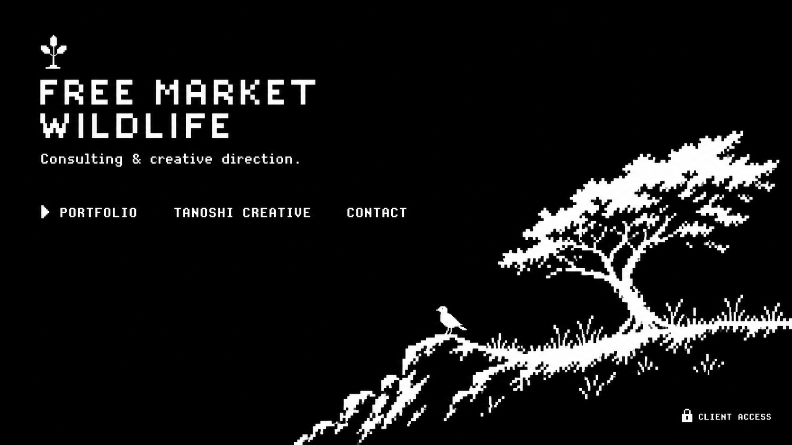
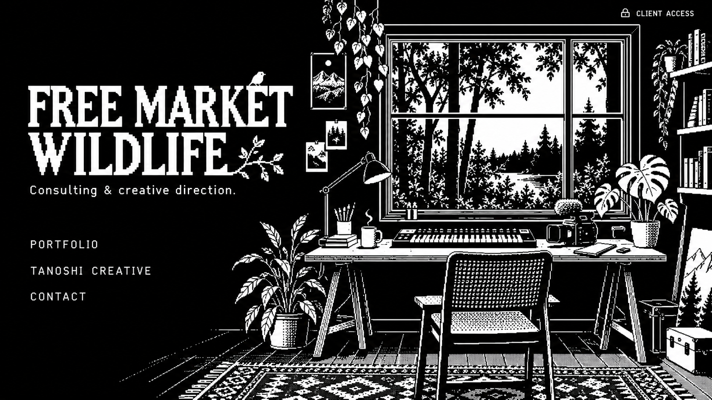
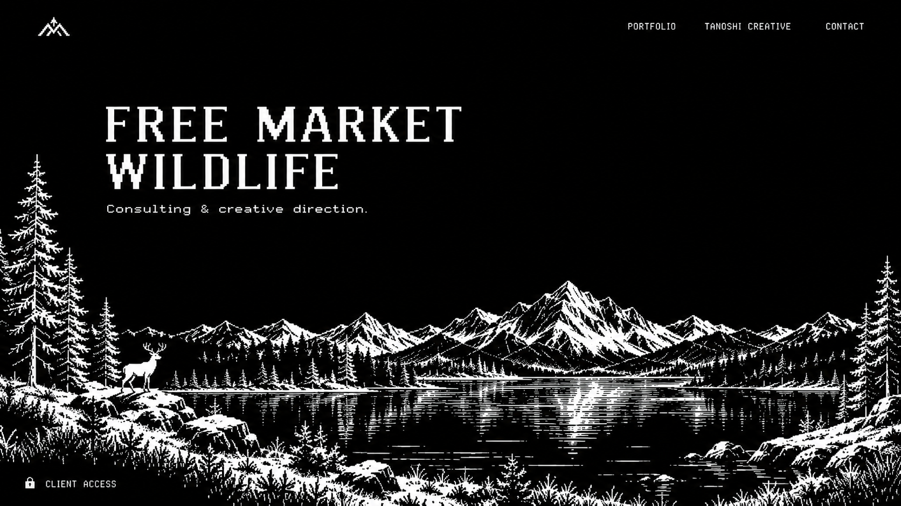

# Black and white landing-page concepts

Generated with the built-in imagegen tool. Concept studies only; no site restyling has been applied.

The dimensions below are **target logical art grids**, not exact native generated-image resolutions. During implementation, selected art needs an enforced pixel grid, nearest-neighbor scaling and verified 1-bit black/white palette. The generated concept images are visual references, not production-ready pixel assets.

## 01-the-clearing

Target logical pixel budget: 256 × 144.



### Generation prompt

```text
Use case: ui-mockup. Create ONE polished website landing-page concept image for Free Market Wildlife, landscape 16:9, front-on flat screenshot, no monitor or browser frame. Concept 1: THE CLEARING. The entire image is authentic extremely low-resolution 1-bit pixel art, target logical art grid 256x144 pixels, magnified nearest-neighbor approximately 6x for a visibly chunky pixel budget. This is the lowest-detail of three budget studies. Absolutely ONLY pure black #000000 and pure white #ffffff; NO gray, colors, antialiasing, gradients, blur, shadows, bloom, grain, or soft edges. Restrained and human-designed, stylish indie pixel-art website with generous solid BLACK negative space, a tiny white pixel tree sapling brand mark, small bitmap typography, precise pixel alignment. Upper left display 'FREE MARKET' then 'WILDLIFE' in compact beautifully drawn white pixel lettering. Below, a short small sentence 'Consulting & creative direction.' Right side contains a spare pixel-art silhouette of one wind-swept tree and a tiny bird on a short grassy ridge, strong composition, art confined to lower-right third, white silhouettes and a little black cutout detail. Three plain text navigation links well separated on a single row under title: 'PORTFOLIO', 'TANOSHI CREATIVE', 'CONTACT'; small squared pixel arrow beside active link. Bottom-right tiny white pixel lock with 'CLIENT ACCESS'. Keep every text readable even in a coarse 5x7 or 5x9 bitmap font. Only these text elements. No bordered cards, no bento grid, no dashboard, no terminal UI, no tech decoration, no cyan, no neon, no generic AI aesthetics. Coarse deliberate blocky silhouette artwork; sparse elegant black-and-white webpage with actual usable landing layout.
```

## 02-the-studio

Target logical pixel budget: 512 × 288.



### Generation prompt

```text
Use case: ui-mockup. Create ONE premium website landing-page concept image for Free Market Wildlife, landscape 16:9, front-on flat screenshot, no device or browser frame. Concept 2: THE STUDIO. Authentic 1-bit pixel art at a target logical art grid 512x288 pixels, shown with clean nearest-neighbor magnification approximately 3x: medium pixel budget, distinctly more resolved than a chunky 256x144 design and distinctly less fine than 1024x576. Only pure BLACK #000000 and pure WHITE #ffffff in the ENTIRE image, no gray, off-white, tint, gradients, antialiasing, smooth vector curves, blur, glow, or photography. The site is simple, dark mode, warm in character through composition rather than color, carefully art-directed with much black negative space. Left half: large custom bitmap wordmark 'FREE MARKET' on one line and 'WILDLIFE' below, then 'Consulting & creative direction.' Small white pixel nav links vertically separated underneath: 'PORTFOLIO', 'TANOSHI CREATIVE', 'CONTACT'. Right half: one beautifully drawn pixel-art artist's workspace viewed straight-on in a single illustration, a desk by a window looking into trees, a simple music keyboard and a small video camera, a potted plant. Carefully compose a cohesive modest creative studio, NOT separate product cards, NOT an app dashboard, not a cluttered inventory. Window and table silhouettes mostly white fine stepped edges and sparse binary white hatch detail on black; use only black-white pixels. Title and text remain visually dominant and legible. Tiny white pixel lock and 'CLIENT ACCESS' in a quiet upper-right corner. The art serves the simple navigation. Crisp balanced editorial spacing, no fake statistics, no unnecessary text, no buttons inside boxes, no rounded rectangles, no cards, no corporate UI, no neon or futuristic tropes. Draw the entire design as deliberate high-quality medium-budget pixel art.
```

## 03-wild-horizon

Target logical pixel budget: 1024 × 576.



### Generation prompt

```text
Use case: ui-mockup. Create ONE exceptionally beautiful simple dark-mode website landing-page concept art screenshot for Free Market Wildlife, 16:9 landscape, flat website view, no browser chrome, no photographed screen. Concept 3: WILD HORIZON. High pixel budget: target logical 1-bit art grid 1024x576, fine individual square pixels, much finer resolution and more detailed hand-pixeled scenery than a 512x288 or 256x144 piece. Strict palette exactly pure black #000000 and pure white #ffffff, absolutely no grayscale, no colored accent, no gradient, glow, anti-aliasing, smoothing, or painterly texture. Black background dominates. Upper left a small custom white pixel brand mark, upper right very small spare links 'PORTFOLIO' 'TANOSHI CREATIVE' 'CONTACT', all elegantly spaced in crisp white bitmap lettering. Upper central-left is the white title 'FREE MARKET' and second line 'WILDLIFE', confident well-spaced custom pixel typography. Beneath title 'Consulting & creative direction.' Keep large calm unfilled black sky around the type. The bottom 40 percent of the viewport is one continuous meticulously composed pixel-art panoramic wild mountain lake landscape: sparse pines at edges, jagged distant mountain outline, a slender lakeshore, tiny white reflections constructed from horizontal 1-bit pixel strokes, foreground black grasses cut out of white rock, one small standing deer silhouette near a pine. Restrained high-quality pixel composition with cinematic negative space, detail concentrated at the horizon and corners, no full-screen noise or dithering that competes with words. Bottom left a tiny white pixel lock and 'CLIENT ACCESS'. A sophisticated artist's personal website, NOT dashboard, NO bento tiles or cards, NO boxed widgets, no illustrations in separate panels. Pixel artwork feels authored and original. All copy exact as given; no other words or claims. The design should be immediately usable as a clean single-screen landing page with beautiful detailed binary pixel scenery.
```

